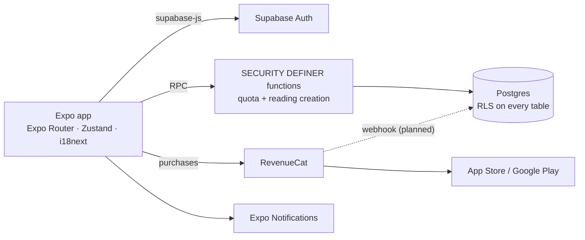

<div align="center">

# 🌙 TaroLuna

**A cross-platform tarot app for iOS and Android — 78 cards, 9 spreads, 4 languages, freemium with in-app purchases.**

[](https://github.com/faceitall123qwe-hub/taroluna/actions/workflows/ci.yml)


<sub>Home · Card of the day · Deck browser · Card meaning · Paywall (localised pricing)</sub>

</div>

---

## Features

- **Full 78-card deck** with upright and reversed meanings, element and planet per card
- **9 spreads** — card of the day, past–present–future, mind–body–spirit, Celtic Cross, yes/no,
  shadow self, career path, relationship dynamics, monthly forecast
- **4 languages** — UI in English, Polish, Russian and Ukrainian (auto-detected); card names in
  all four, full card texts in EN / RU / UK
- **Freemium** — 3 free readings, then reading packs or a monthly/annual subscription via
  RevenueCat, with localised prices (PLN / EUR / USD)
- Card of the day with push reminders, reading history, zodiac tab
- Auth: e-mail/password, Apple Sign-In (with nonce), password reset
- Dark "cosmic" design system, large touch targets for a 30–60 target audience

## Architecture



Card content is bundled with the app (offline-first); only accounts, readings and
entitlements live in the backend.

## Security

The quota and paywall logic is enforced in Postgres, not in the client. A
[security review](SECURITY_REVIEW.md) of the first version found and fixed:

| Severity | Issue | Fix |
|---|---|---|
| Critical | `SECURITY DEFINER` functions trusted a `p_user_id` argument — any user could spend or read another user's quota | Every function now checks `p_user_id = auth.uid()` |
| High | Apple Sign-In without a nonce (replay risk) | SHA-256 nonce passed to Apple and verified by Supabase |
| High | Subscription state trusted from the client store after purchase | Profile re-fetched from the server; the reading gate is a server-side RPC and `subscriptions` has no client write policies |
| Medium | Unbounded text fields | DB-level `CHECK` constraints mirror client `maxLength` |
| Low | Raw auth errors shown to users | Mapped to safe messages |

## Run

```bash
npm install
cp .env.example .env                 # Supabase URL + anon key; RevenueCat keys optional
bash scripts/download-card-images.sh # card art (MIT, metabismuth/tarot-json)
npx expo start                       # iOS / Android / web
```

Apply `supabase/migrations/*.sql` in order, then `supabase/seed.sql`.
Without RevenueCat keys the paywall uses mock offerings, so the whole flow works in development.

```bash
npm run typecheck && npm run lint    # same checks as CI
```

## Project structure

```
app/                Expo Router screens: tabs, reading flow, card detail, auth, paywall
src/components/     cards, spreads, paywall, UI kit
src/data/           78-card dataset, spreads, translations
src/services/       Supabase, RevenueCat, notifications
src/hooks/          auth, readings, purchases, card of the day
supabase/           migrations (schema, functions, hardening) + seed
```
