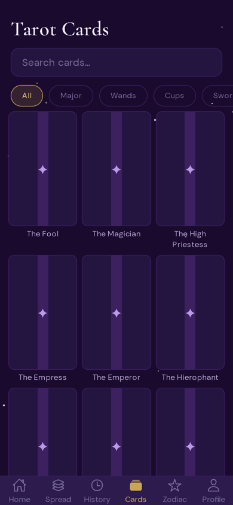
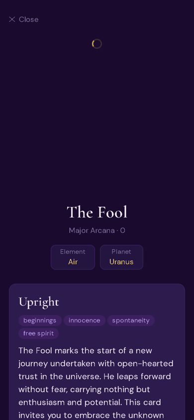
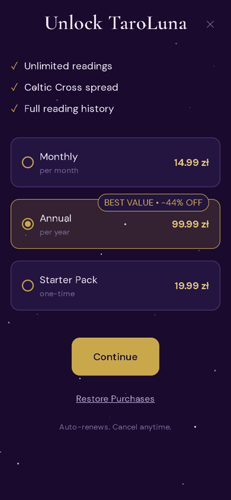

# TaroLuna

[](https://github.com/faceitall123qwe-hub/taroluna/actions/workflows/ci.yml)

Tarot app for iOS and Android, built with Expo. It has the full 78-card deck, nine spreads and
a card of the day, in English, Polish, Russian and Ukrainian. The first three readings are
free; after that there are reading packs or a subscription through RevenueCat.

<p>





</p>

## Features

- 78 cards with upright and reversed meanings, element and planet
- Spreads: card of the day, past/present/future, mind/body/spirit, Celtic Cross, yes/no,
  shadow self, career path, relationship dynamics, monthly forecast
- Language picked from the device. The interface is translated into all four languages,
  full card descriptions exist in English, Russian and Ukrainian (Polish falls back to English)
- Reading history, daily reminder notifications
- Sign in with e-mail or Apple
- Prices shown in PLN, EUR or USD depending on the device locale

## Backend

Supabase (Postgres + Auth). Card texts are bundled with the app, so the backend only stores
accounts, readings and subscription state.

The free-reading limit is enforced in Postgres functions, not in the app. A security review of
the first version showed that those functions took a user ID as a parameter and trusted it,
so any logged-in user could use up someone else's free readings. They now check it against
`auth.uid()`. The rest of that review (Apple sign-in nonce, subscription state, length limits)
is in [SECURITY_REVIEW.md](SECURITY_REVIEW.md).

Still to do before release: a RevenueCat webhook that writes subscription status to the
database server-side.

## Running

```bash
npm install
cp .env.example .env                  # Supabase URL and anon key, RevenueCat keys are optional
bash scripts/download-card-images.sh  # card artwork, MIT licensed (metabismuth/tarot-json)
npx expo start
```

Apply the SQL files in `supabase/migrations` in order, then `supabase/seed.sql`. Without
RevenueCat keys the paywall shows test products, so the purchase flow can be tried locally.

`npm run typecheck` and `npm run lint` are what CI runs.

## Stack

React Native 0.74, Expo SDK 51, Expo Router, TypeScript, Zustand, i18next, Supabase,
RevenueCat, Expo Notifications.
